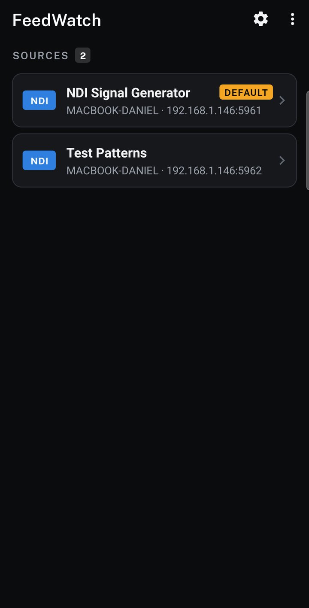
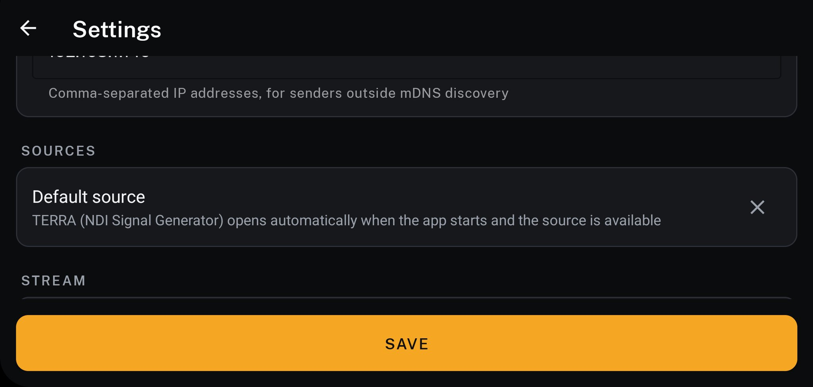
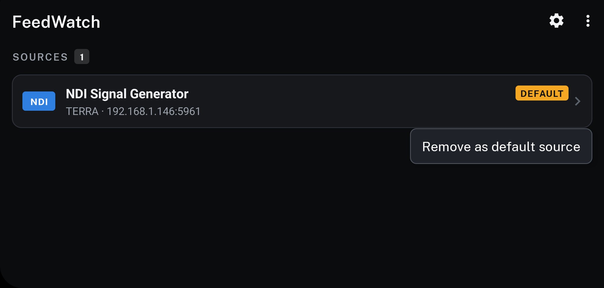
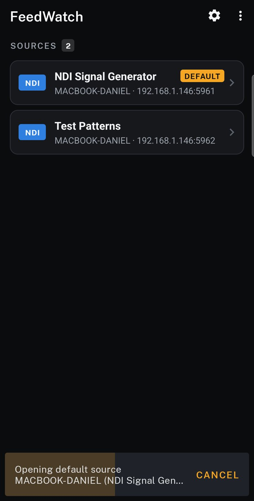
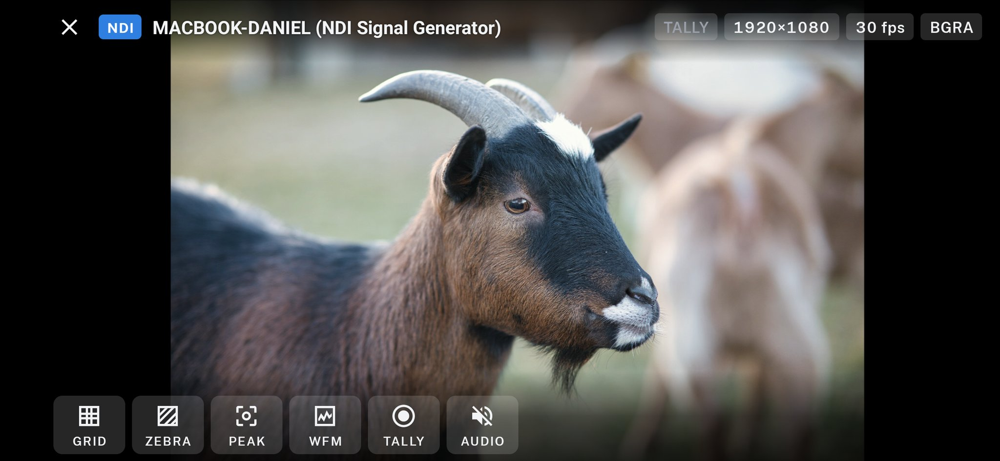
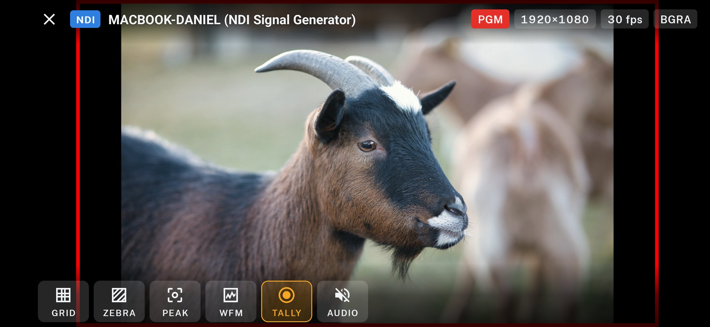
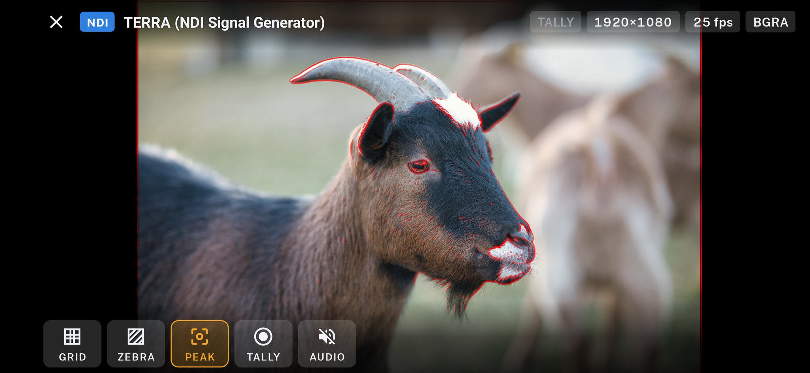
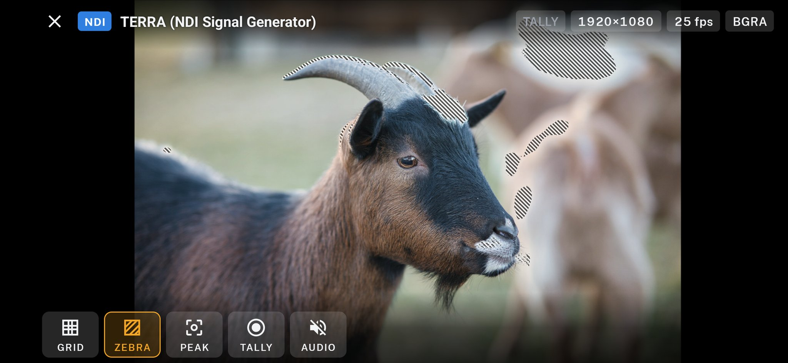
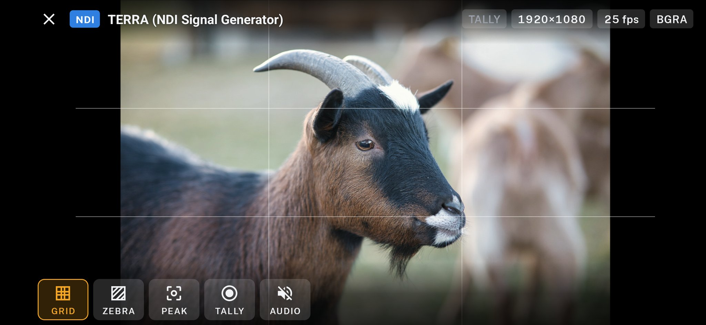

# FeedWatch

Android App to view [NDI®](http://ndi.tv/)- or UVC (**U**SB **V**ideo **C**lass Device) Feed on an Android mobile phone.

This project was renamed from NDIMonitor to FeedWatch to avoid confusion with the official 
NDI® Tools app "NDI® Video Monitor" and I don't want to get in trouble with Vizrt ;)

## Features

### Video Sources

All sources the app finds are listed on the start screen: NDI® sources from the network and UVC devices connected
via USB. The list updates itself in the background, pull down to refresh it right away. Tap a source to open it.

- **NDI® High Bandwidth Monitoring**
    - Supports NDI® High Bandwidth sources
    - Since NDI® can be network-intensive, using a **USB-C Ethernet adapter** is strongly recommended.
    - NDI® senders outside mDNS discovery can be added by their IP address in the Settings. The dot after
      a full block of three digits is added for you. Changes apply right away.

      
    - **NDI® HX** is currently not supported. I invested some effort and implemented
  a working prototype. However, in order to receive NDI® HX streams for
  longer than 5 minutes, you need currently a NDI® Advanced SDK license.
  Even if I had a license - which I do not - publishing the source code
  would not be useful, because I would not be able to publish the license
  itself. Anyone who wanted to use this functionality would need to obtain
  the appropriate license independently.

- **UVC HDMI Capture Cards**  
  The app can capture video from **UVC-compatible devices**, such as USB HDMI capture cards.  
  This functionality was developed and tested with a low-cost **UGREEN Video Capture Card** (Amazon), which performed
  reliably.  
  Any supported UVC device will automatically appear as an available source.

### Default Source

Long-press a source and choose **Set as default source** to open it automatically. There can only be one default
source, it is marked with a **DEFAULT** badge.

Once per app start, the default source opens as soon as it is available. A short countdown is shown before, tap
**Cancel** to stay on the source list. Closing the stream returns to the list without opening the source again.

The default source can also be removed in the Settings, even while it is not available.

### Stream View

Tap the picture to show or hide the controls. The top bar shows the source, its tally state, resolution, frame rate
and pixel format. The bottom bar switches the monitoring tools and audio.

### Audio

NDI® audio is played back together with the picture, with a level meter for the left and right channel. Use the
**AUDIO** button to mute it. Without audio, the picture is shown with the lowest latency instead of waiting for its
audio.

### Low Bandwidth Mode

Low Bandwidth Mode reduces network and CPU usage by using the NDI proxy stream instead of the full-resolution video feed. This mode is ideal when your android device is only connected to a wireless network. 
While image quality is reduced compared to the full NDI stream it can nevertheless be enough to check feed existence, framing or exposure. 

You can enable Low Bandwidth Mode in the app’s Settings (gear icon on the source list).

### Viewer Mode

Viewer Mode shows only the picture: monitoring tools, overlays and stream info are hidden, only the close and audio
buttons remain. It can be enabled in the Settings.

---

## Monitoring Tools

### NDI Tally

- Displays NDI® tally information (red for program /green for preview) for NDI sources

### Focus Peaking

- Simple focus peaking implementation
- Fixed sharpness sensitivity: **70%**
- Edge color **red**, **yellow** or **blue**: long-press the **PEAK** button to choose it

---

### Zebra

- Exposure warning using zebra stripes
- Fixed threshold: **95 IRE**

---

### Grid Overlay

- **3×3 composition grid** for framing assistance

## Build Requirements

Before building, we need to make sure that the following components are installed:

- Java Development Kit (JDK) 11
- Android SDK Platform 33
- NDI SDK for Android

### 1. Java 11

This project must be built with Java 11. Newer Java versions (e.g. Java 17) may cause Gradle or NDK build failures.
The reason is, that this project should be runnable on older phones. Android SDK Platform Level 33 uses Java 11.

### 2. Android SDK

Install Android SDK Platform 33. Instruction can be
found [here](https://developer.android.com/about/versions/13/setup-sdk)

### 3. Download and Install the NDI SDK

Download the NDI SDK for Android from the [official site](https://ndi.video/for-developers/ndi-sdk/download/)

Follow the installer instructions for your platform and note the installation directory.

### 3.1 Copy NDI Header Files

After installation, copy the NDI header files into the project’s C++ include directory:

`cp <NDI_SDK_INSTALL_DIR>/NDI\ SDK\ for\ Android/include/* \ <PROJECT_ROOT>/FeedWatch/app/src/main/cpp/include/`

### 3.2 Copy NDI Library Binaries

Next, copy the NDI library binaries into the project’s jniLibs directory:

`cp <NDI_SDK_INSTALL_DIR>/NDI\ SDK\ for\ Android/lib/* <PROJECT_ROOT>/FeedWatch/app/src/main/jniLibs/`

Ensure that the copied libraries match the ABIs you intend to build for (e.g. arm64-v8a, armeabi-v7a).

### 4. Build the Project

`./gradlew assemble`

## State of this project

This app is in a very early development phase. Therefore it is not fully tested. It is possible that the app does not
work stable and that there are some ui or- performance glitches.

## License

NDI® is a registered trademark of the Vizrt Group. Also visit http://ndi.video for details.

This project is licensed under the APACHE License 2.0. See included [LICENSE](LICENSE) file.
